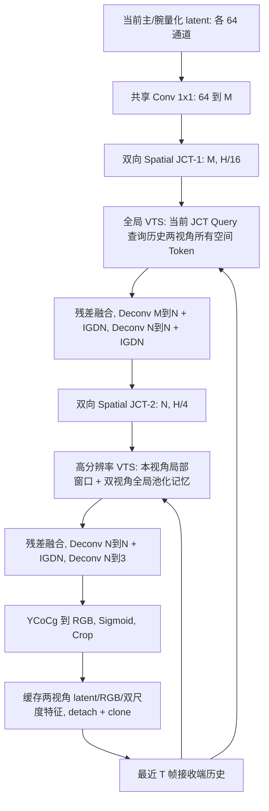

# Decoder-v5：宽 Decoder 与双尺度 View–Temporal–Spatial Attention

本次基于 `codec` 分支 `0be7e9ebfe30b0a252be8ece8a608964aec1695c` 实现。
Encoder、Gain、HyperGain、Hyperprior、概率模型、熵编码和 ECD1/ECG1/ECH1 格式不变。
**默认组合为 64 通道轻量分析端 + 320/192 通道 Decoder + 8 帧双视角历史。**
仅执行 CPU 双线程功能/反向传播/开销测试，没有启动 V5 正式训练，不声称 PSNR 或 BPP 提升。

## 训练隔离

正在运行的八档 V4 训练脚本从
`outputs/v4_eight_beta_20261104/source_snapshot` 导入 `compress`，其后续评估也使用同一快照。
本次只编辑 `ecomp_codec_publish`，不更改该快照、优化器、训练进程、checkpoint 或日志。
开发前后逐文件核验快照 SHA-256，并记录训练步数继续推进；核验见 `decoder_v5_training_isolation.json`。
没有使用 GPU 做 V5 测试，不停止或重启现有训练。

## 可配置入口与旧版兼容

```python
from compress.dual_view_codec import DualViewCodec

model = DualViewCodec()                       # vts8, M=320/N=192, T=8
model = DualViewCodec(decoder_config='vts16')  # M=320/N=192, T=16
old = DualViewCodec(decoder_config='baseline') # 原 decoder.py，M=N=64/T=2
```

| 配置名 | M/N | 历史 T | 模块 |
|---|---|---|---|
| baseline | 64/64 | 2 | 完整原 V4，双路独立 Efficient Temporal |
| wide-ldmic | 192/128 | 2 | 扩宽的原式 Efficient Temporal |
| wide-elic | 320/192 | 2 | 扩宽的原式 Efficient Temporal |
| long-history | 320/192 | 8 | 扩宽的原式 Efficient Temporal |
| vts8（默认） | 320/192 | 8 | 双尺度 VTS |
| vts16 | 320/192 | 16 | 双尺度 VTS |

可传 `history_size=...` 覆盖窗口，非 baseline 可通过 `M=...`、`N=...`、
`window_size=8`、`memory_grid=4`、`query_chunk=64` 配置。M/N 必须为 32 的倍数。
旧 `compress.decoder.SpatioTemporalDecoder` 本身保持 V4，不修改其权重命名或数学逻辑。
`DualViewCodec()` 的默认值改为 V5；所有历史测试、历史 benchmark 和旧图片 smoke 已显式固定 baseline。

## 数据流与逐层结构



以下每个张量分别对 main/wrist 成立，不要求两相机空间尺寸相同。以 256×256、batch=1 为例：

| 层/模块 | 输入 | 输出 | Attention Head/激活/残差 |
|---|---|---|---|
| input_project，共享 1×1 Conv | 1×64×16×16 | 1×320×16×16 | 线性，无 Encoder skip |
| atten_3，JCT-1 | 两路 1×320×16×16 | 两路同形状 | QK=40、V=80、4 heads；原 ResidualBlock/LeakyReLU，外层残差 |
| vts_low | 当前 JCT 特征 + 最近 T 帧两视角历史 | 同当前形状 | 8 heads，head_dim=40；LayerNorm、token SDPA，门控残差 |
| decoder_1[0:2] | 1×320×16×16 | 1×192×32×32 | 5×5 stride-2 Deconv + IGDN |
| decoder_1[2:4] | 1×192×32×32 | 1×192×64×64 | 5×5 stride-2 Deconv + IGDN |
| atten_4，JCT-2 | 两路 1×192×64×64 | 两路同形状 | QK=24、V=48、4 heads；同 JCT 残差拓扑 |
| vts_high | 当前 JCT 特征 + 高分辨率历史 | 同当前形状 | 8 heads，head_dim=24；8×8 查询窗口 + 4×4/视角/帧全局记忆 |
| decoder_2[0:2] | 1×192×64×64 | 1×192×128×128 | 5×5 stride-2 Deconv + IGDN |
| decoder_2[2] | 1×192×128×128 | 1×3×256×256 | 5×5 stride-2 Deconv |
| RGB head | YCoCg logits | 1×3×原始 H×W | ycocg_to_rgb → Sigmoid → Crop |

两路共享输入投影、空间主干、重建头与各尺度 VTS 参数。VTS 内使用视角身份区分 Query/K/V。
JCT 两个尺度的参数独立；VTS 两个尺度参数也独立。
没有额外添加主干残差细化块；新增特征融合只发生在历史 K/V 的 1×1 Conv+GELU 中。
64/64 宽度下，JCT 为原有 2 heads；较宽配置为 4 heads，QK=C/8、V=C/4 随宽度扩展。

## 历史与因果机制

V5 的 `DecodedFrame` 同步保存两视角各自的：

- 64 通道解码 latent；
- 已完成的重建 RGB；
- H/16 的 M 通道、完成低尺度融合后的特征；
- H/4 的 N 通道、完成高尺度融合后的特征。

全部 `detach().clone()`；两路来自同一调用、同一 Episode/时间帧。
`DecoderState` 保存 episode_id、next_frame、有序 history 和结构 signature。
signature 包含 M/N/T、时序种类、窗口、池化网格、查询块大小。
第 0 帧忽略旧状态并重建空历史；其余帧要求 Episode 相符、frame_index 连续，
历史长度等于 min(frame_index,T)，并检查状态类型、结构签名、batch/channels/device/dtype。
不接受缺失、乱序、跨 Episode、旧 V4 状态；不能把未来帧当合法 next_frame 输入。

直接引用的缓存窗口为最近 T 帧。缓存 Decoder 特征可能包含其解码时合法的更早上下文，
因此总感受野可以超过 T 帧；这不意味着访问未来帧。当前原始 RGB 不进入 Decoder 接口。
历史图像是重建结果，不是训练标签。当前时间步的参数可反向传播，历史计算图不跨帧延伸。

## View × Time × Space Attention

每个尺度从已经完成当前跨视角 JCT 的特征产生 Query。
对历史帧 τ、视角 v，以历史 Decoder 特征的自身尺寸为基准，将 64 通道 latent
投影并 resize，RGB 自适应池化并投影，与缓存特征 Concat：

```
R = GELU(Conv1x1(Concat(latent_projection, rgb_projection, cached_decoder_feature)))
K,V = Linear(LayerNorm(R + age_embedding[τ] + view_embedding[v]))
Q = Linear(LayerNorm(current_JCT_feature + query_view_embedding))
```

各空间 Token 保持独立，计算：

\[
\alpha_{p,\tau,v,q}=\operatorname{softmax}_{\tau,v,q}
\left(\frac{Q_p^\top K_{\tau,v,q}}{\sqrt{C/h}}
+b_\tau+b_v+f_\theta(u_p-u_q)\right),
\quad
X'_p=X_p+\tanh(g)\odot W_o\sum_{\tau,v,q}\alpha_{p,\tau,v,q}V_{\tau,v,q}.
\]

`u` 为各视角自身归一化的像素/池化单元中心坐标；相对位置网络为
Linear(2,32) → SiLU → Linear(32,heads,bias=False)。年龄偏置与视角偏置逐 head 学习。
年龄编码最新为 1，最旧为 T；年龄与视角也加入特征层的 K/V。
Key projection 不含公共 bias，相对位置输出也无公共 bias，避免引入会被 Softmax 抵消的无效参数。
每个通道门控参数初始 0.01，残差接近恒等，同时首次有历史时 Q/K/V 即可获得梯度。

### H/16 全局关联

最近 T 帧两视角的所有空间 Token 都作为 K/V，不做全局统计矩阵压缩。
Query 按最多 64 个 Token 分块调用 PyTorch SDPA；每个 Query 仍查询完整历史 K/V。
不使用额外 padding Token，视角/帧分别 flatten 后拼接，所以不需要 padding mask。
不同历史/当前分辨率使用各自归一化位置坐标。

### H/4 高分辨率关联

每个查询窗口默认 8×8。K/V 同时包括：

1. 最近 T 帧**同视角**的高分辨率局部窗口，保留细节；历史分辨率变化时仅在同视角内 resize。
2. 最近 T 帧**两视角**各最多 4×4 的全局池化记忆，允许从另一相机的任意区域获取信息。

不在跨相机之间强制对应像素位置；全局参考的相对位置只是可学习软偏置，不是硬对应约束。
边缘不足 8×8 的窗口直接裁成实际大小，不填无效 Token。
相对位置仍在原视角归一化坐标中计算，本地窗口不会错误地重新归一化成完整图像。
同视角既有局部细节又有全局记忆，这是本实现相对任务建议的具体选择。

256×256、T=16 时低尺度单个 Query chunk 的 K 长度 8192；高尺度每窗 K 长度最多
16×2×16 + 16×64 = 1536；不会显式分配覆盖全部 H/4 Query 的完整稠密矩阵。
SDPA 与相对偏置仍有实际开销，训练图会保存各块反向传播所需信息，不能将分块等同于零显存开销。

## Checkpoint 迁移

V4 Decoder 权重不能直接严格加载到默认 V5，通道数、模块集合、历史状态均不同。
使用显式迁移并审查报告：

```python
import json
import torch
from compress.dual_view_codec import DualViewCodec
from compress.decoder_v5 import migrate_checkpoint

saved = torch.load('old.pt', map_location='cpu', weights_only=False)
old_state = saved['model']
torch.manual_seed(5)
model = DualViewCodec(levels=old_state['analysis.gain.log_gain'].shape[0], decoder_config='vts8')
migrated, report = migrate_checkpoint(old_state, model)
model.load_state_dict(migrated, strict=True)
print(json.dumps(report, indent=2))
```

分析端完整严格加载，包含熵编码动态 CDF buffers，任何缺失/多余键或不兼容 Gain 档位都报错。
Decoder 仅迁移同名且同形状参数，所有复制/新初始化/丢弃源键都逐项报告。
新投影、宽卷积、Q/K/V 使用 PyTorch 默认初始化；嵌入使用 Embedding 默认初始化，
padding_idx=0 行为 0；门控显式为 0.01。需要全新 Decoder 时可传 `copy_compatible_decoder=False`。
没有使用 `strict=False`。

必须重新建立 optimizer；不能恢复旧 Decoder 优化器槽位。
旧 DecoderState 不迁移，部署新模型后从 frame_index=0 建立历史。
配置/权重/CDF 必须由发送和接收两端共享，未添加任何包头字段。
固定分析端/CDF/档位/输入后 packet bytes 保持相同，但新旧 Decoder 重建可以不同。

## 参考源码继承关系

- [LDMIC models/ldmic.py](https://github.com/Xinjie-Q/LDMIC/blob/main/models/ldmic.py)：
  保留两级双向 JCT 的 rb1/rb2/refine 残差拓扑及 Deconv+IGDN；宽配置参考 M=192/N=128。
  本项目 Encoder latent 仍为 64 通道，因此新增 Decoder 内部 64→M 投影。
- [CompressAI Elic2022Official](https://github.com/InterDigitalInc/CompressAI/blob/master/compressai/models/sensetime.py)：
  参考其 M=320/N=192 宽度及增强解码思想；没有复制其 g_a、分组上下文或熵模型，
  本实现也不是原 ELIC g_s 的残差/AttentionBlock 堆叠。
- [BiSIC_models.py](https://github.com/LIUZhening111/BiSIC/blob/main/BiSIC_models.py)、
  [bidirectional_attention.py](https://github.com/LIUZhening111/BiSIC/blob/main/lib/bidirectional_attention.py)：
  参考双向交互与跨维度建模思想，没有引入其 3D 熵模型或直接复制其 factorized Attention。

双尺度 VTS、三源历史融合、时间/视角/相对位置偏置、局部+全局混合记忆为本项目新设计，
不能称为以上论文已经提出的同一结构。参考在线源码核对日期：2026-11-04。

## 训练入口适配与复现

原 `tools/train_libero.py` 保留旧 baseline 为该历史入口的默认值，增加
`--decoder-config`、`--history-size`，V5 参数/梯度日志正确绑定新历史融合与年龄表。
它仍保持逐 Episode 连续帧、每帧一次原 RD 损失，未启动该数据集训练。
现有八档训练脚本独立运行，未改其 β、loss 或日志配置。

最小连续三帧 CPU 联合训练例子（随机图像，只验证前向、历史与反向传播）：

```sh
CUDA_VISIBLE_DEVICES='' OMP_NUM_THREADS=2 MKL_NUM_THREADS=2 \
python tools/smoke_decoder_v5.py --decoder-config vts8 --frames 3 --size 64
# 显式迁移旧权重，并打印完整迁移清单：
CUDA_VISIBLE_DEVICES='' OMP_NUM_THREADS=2 MKL_NUM_THREADS=2 \
python tools/smoke_decoder_v5.py --checkpoint /path/old.pt --frames 3
```

此例保留 `estimated_bpp + beta * 255² * (main_mse+wrist_mse)/2` 和 quantiles 独立辅助优化器。
模型/源码文件修改不代表对新 Decoder 已完成正式训练。

## 修改文件清单

- 新增 `compress/decoder_v5.py`：V5 DecodedFrame/DecoderState、ScaledJointContextTransfer、
  ViewTemporalSpatialAttention、SpatioTemporalDecoderV5、build_decoder、migrate_checkpoint。
- 修改 `compress/dual_view_codec.py` 构造与状态类型注解；forward/compress/decompress 的编码、BPP 数学不变。
- 新增 `tests/test_decoder_v5.py`：12 项 V5 功能/维度/因果/梯度/真实码流测试。
- 修改 `tests/test_dual_temporal.py`、`test_dual_view_codec.py`、`test_history_fusion_age.py`、
  `test_hypergain.py`、`test_ldmic_alignment.py`：旧 Codec 实例显式选 baseline，保持历史断言。
- 新增 `tools/smoke_decoder_v5.py`、`tools/benchmark_decoder_v5.py`。
- 修改旧 `benchmark_decoder_alignment.py`、`benchmark_dual_temporal.py`、
  `benchmark_history_fusion.py`、`smoke_dual_view_codec.py`：固定旧 baseline。
- 调整既有未跟踪训练入口 `tools/train_libero.py` 的配置/历史/梯度适配；不覆盖其原有训练功能。
- 更新 `README.md`；新增本报告、原始开销 JSON、CPU 测试日志和训练隔离核验 JSON。
- `lightweight_encoder.py`、`gain.py`、`hyperprior.py` 和旧 `decoder.py` 均未修改。

## 测试结果与开销

测试和开销实测结果附于下文。GPU 推理显存和延迟未测，以避免干扰现有训练；不提供虚构数值。

### 实测结果（CPU 双线程）

B=1、主/腕各 256×256、float32、填满配置历史；各配置独立子进程，预热 1 次、计时 3 次中位数。
随机 latent，缓存为独立 clone 的历史条目；测试不包含熵解码。延迟包含两路 Decoder 和新缓存复制。
CPU 峰值是整个子进程 RSS，包含解释器、模型、缓存和临时张量，不等于网络激活或 GPU 显存。

| 配置 | Decoder 参数 | JCT-1 参数 | JCT-2 参数 | 时序参数 | 缓存 MiB | 名义 GMAC | 双路延迟 ms | 峰值 CPU RSS MiB |
|---|---:|---:|---:|---:|---:|---:|---:|---:|
| baseline | 1,072,387 | 343,712 | 343,712 | 60,288 | 3.25 | 4.523 | 379.63 | 696.66 |
| wide-ldmic | 6,480,995 | 3,089,376 | 1,373,504 | 512,512 | 12.00 | 19.180 | 1339.29 | 750.46 |
| wide-elic | 16,601,987 | 8,579,360 | 3,089,376 | 1,407,104 | 16.50 | 44.190 | 2307.25 | 837.79 |
| long-history | 16,603,907 | 8,579,360 | 3,089,376 | 1,409,024 | 66.00 | 47.837 | 1294.96 | 867.49 |
| vts8 | 16,216,179 | 8,579,360 | 3,089,376 | 1,021,296 | 66.00 | 64.360 | 8258.19 | 1014.19 |
| vts16 | 16,220,403 | 8,579,360 | 3,089,376 | 1,025,520 | 132.00 | 86.032 | 15552.43 | 1196.68 |

所有配置的 Encoder 均为 **12,558 参数**；完整分析端（8 档 Gain/Hyperprior）均为 **502,222 参数**。
VTS-8 完整 Codec 为 **16,718,401 参数**。主干宽度明显增加，时序参数没有直接扩展到同量级。
V5 Efficient 配置也保留双尺度状态字段，虽然其原式时序分支只使用 latent/RGB；缓存开销如实包含这些字段。

MAC 统计包含 Conv/Deconv、GDN 通道混合、Linear、JCT factorized attention、SDPA 的 QK 与 AV，
不包含 Softmax、LayerNorm、激活、插值/池化、逐元素操作和熵编码。原始分项和三次延迟见 `decoder_v5_metrics.json`。
主机负载波动大，样本少；尤其某长历史配置实测快于短历史，不应解释为算法加速。
GPU 峰值显存/延迟未测，没有将 CPU RSS、缓存大小或理论矩阵大小冒充 GPU 实测。后续需在空闲设备上单独测量。

### 通过的测试

最终全套 **65/65 通过，87.267 秒**，CPU 双线程；其中新增 V5 12 项。
连续三帧训练 smoke 通过，history_used 为 0、1、2；没有正式训练 V5。

| 类别 | 验证结果 |
|---|---|
| 默认维度 | M320/N192，双路 256×256 输出；两尺度缓存形状正确 |
| 不同分辨率 | main 256×256 / wrist 128×192，连续有历史重建正确 |
| 历史 | T8/T16，覆盖 0/1/2/8/16 帧、长度裁剪、reset、乱序、跨 Episode、旧状态拒绝 |
| 历史来源 | 改主/腕 latent、RGB、低/高尺度缓存都影响当前两视角，非仅 Shape 测试 |
| 身份与空间 | 改年龄、视角身份、空间排列均改变结果；空历史严格恒等 |
| 真正 Token Attention | 分块 SDPA 与小规模显式稠密 QK Softmax AV 数值一致 |
| 梯度 | 连续三帧下，扩展层、两级 JCT、双尺度 VTS 所有参数梯度有限且总幅值 >1e-12 |
| 窗口 | 不整除窗口、不同历史分辨率、batch=2，前向和反向正确 |
| 码流 | 固定分析端/CDF，新旧 packet bytes 完全一致；跨四帧独立接收端与 forward 一致 |
| 迁移 | 严格保留分析端及动态 CDF；迁移报告列明新初始化，缺失分析权重报错 |
| 原基线 | 旧 V4 strict load 与重建一致，既有 53 项测试继续通过 |

复现命令（在仓库根目录）：

```sh
CUDA_VISIBLE_DEVICES='' OMP_NUM_THREADS=2 MKL_NUM_THREADS=2 python -m unittest discover -s tests -v
CUDA_VISIBLE_DEVICES='' OMP_NUM_THREADS=2 MKL_NUM_THREADS=2 python tools/benchmark_decoder_v5.py --output /tmp/v5_profile_new --samples 3
```

未解决/未验证：V5 训练收敛、PSNR/BPP 收益、独立泛化结果、GPU 实测峰值与时延。
本次既有八档训练始终使用 V4 快照，不能把它的结果归于新 V5。
