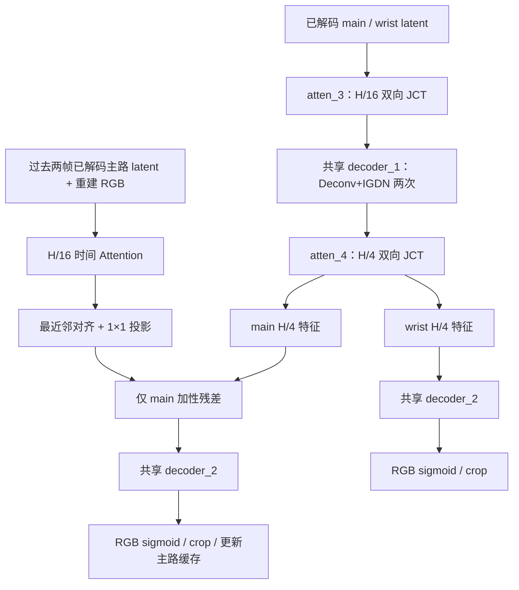

# decoder-v2：LDMIC 空间主干对齐

旧基线：`7db7e58fd891e8979283a51df6be656420ab5cde`，保留在 Git 历史；
测试夹具 `tests/fixtures/decoder_v1.py` 仅调整原相对 import，网络代码不变。
固定上游：[LDMIC 4cf7318505a001c13d9946581f77e2b4af224246](https://github.com/Xinjie-Q/LDMIC/blob/4cf7318505a001c13d9946581f77e2b4af224246/models/ldmic.py)。
依赖沿用 CompressAI 1.2.8，不改安装包或分析端。

## 逐层对照

以下 B=1、两路原图均 256×256。官方默认 M=192/N=128；适配版 M=N=64。
“结构一致”不意味着默认通道、输出域或完整论文 Codec 相同。

| 官方层 | 本项目对应层 | 本项目输入→输出 | 对齐与刻意差异 |
|---|---|---|---|
| 已解码 latent，M=192 | 现有 InverseGain 输出，M=64 | 两路 64×16×16 | 必要通道适配，分析端不变 |
| atten_3=JCT(M) | atten_3=JCT(64) | 64×16×16→64×16×16 | 模块结构一致，默认通道不同 |
| rb1→rb2，各 ResidualBlock(C,C) | CompressAI 原生两块 | C→C→C | 结构一致；每块两次 3×3/LeakyReLU 和内部 skip |
| EfficientAttention | 8 key/query，16 value，2 heads | target/reference→target 空间 | 同等数学运算，四个 1×1 均有 bias |
| refine: ResidualBlock(2C,C)→ResidualBlock(C,C) | 同配置 | Concat 128→64→64 | 结构一致，第一块含 1×1 skip |
| identity + refine(...) | 相同外层残差 | 64→64 | 同等数学运算，两视角共享 rb1/rb2/attn/refine |
| decoder_1 第一次 deconv(M,N,5,2)+IGDN | deconv(64,64,5,2)+IGDN | 64×16×16→64×32×32 | 结构一致，通道适配 |
| decoder_1 第二次 deconv(N,N,5,2)+IGDN | deconv(64,64,5,2)+IGDN | 64×32×32→64×64×64 | 结构一致，使用原生 deconv/GDN(inverse=True) |
| atten_4=JCT(N) | atten_4=JCT(64) | 64×64×64→64×64×64 | 与 atten_3 不共享参数，内部仍双向共享 |
| 无对应项 | main-only 时间残差 | H/16 上下文→64×64×64 | 项目时序扩展，放在 atten_4 之后 |
| decoder_2 deconv(N,N,5,2)+IGDN | deconv(64,64,5,2)+IGDN | 64×64×64→64×128×128 | 结构一致，通道适配 |
| decoder_2 deconv(N,3,5,2) | deconv(64,3,5,2) | 64×128×128→3×256×256 | 结构一致，末层无 IGDN |
| 原图域输出 | ycocg_to_rgb(logits).sigmoid()→crop | 原尺寸 RGB [0,1] | **仍不一致**；刻意保留既有项目输出头，不称完整复现 |

## 数据流及历史隔离

空间主干不等待重建 RGB，没有双路循环。时间 query 来自当前原始已解码 main latent 的旧 content
特征；历史 reference 保留旧 content(latent)+history_image(pool(reconstructed RGB))。
时间输出只在第二个 JCT **之后**注入 main，不再被任何空间 JCT 传播到 wrist。
首帧直接跳过 temporal 及 temporal_project，严格退化为适配后的纯空间路径。
DecoderState/DecodedFrame 字段、history_size=2、frame 0 reset、按序检查及 detach().clone() 不变。
历史分辨率可改变；补充检查缓存 RGB 的 dtype/device，与 latent 一并防止错用缓存。

## 不等尺寸及 Attention 数值对照

只推广原版 reshape：Query 用自己的 Nq=Hq×Wq，参考用 Nr=Hr×Wr，输出取 Query 的 Hq/Wq。
没有 resize 相机特征来凑相同尺寸；两次 JCT 都支持这种推广。
计算仍是 K 在参考空间 softmax、Q 在每头通道 softmax、(K Vᵀ)ᵀ Q，无 sqrt(d)、LayerNorm、
额外残差或位置编码。参数名采用 keys/queries/values/reprojection，keys bias=True。
旧 EfficientCrossAttention 类名、tuple references 调用及旧投影属性别名保留，但参数存储名改变。

`tests/fixtures/ldmic_official.py` 直接摘录固定上游的 JCT 与普通 EfficientAttention.forward，
不是拿生产实现自己重写 oracle；不含无关训练/deepspeed 导入或未用的 parallel_forward。
同尺寸复制相同权重，float32/float64、两个方向均在 atol=rtol=1e-6 内通过。
另一次 B=2、8×8、float32 测量中 Attention/JCT 的最大绝对差均为 **0.0**。
不等尺寸使用独立逐头 oracle 验证形状、softmax 维度和输入梯度。

官方 keys bias 在参考空间 softmax 中是可抵消常数，真梯度可为零。
测试保留它并要求梯度存在且有限；仅对 keys.bias 放宽“必须非零”，其余参与参数仍验证有效梯度。
没有为使断言通过而添加非原版计算。

## 参数与计算量

| 指标 | 旧简化 Decoder | decoder-v2 |
|---|---:|---:|
| Decoder 可训练参数 | 139,395 | 1,056,611 |
| 完整 Codec 可训练参数 | 641,617 | 1,558,833 |
| 单个 JCT 参数 | 不适用 | 343,712，每级独立一份 |
| H/16 JCT：两视角 MACs | 不适用 | 175,702,016 |
| H/4 JCT：两视角 MACs | 不适用 | 2,811,232,256 |

MACs 按实际 forward hooks 计数，B=1、两视角同尺寸：Conv 输出元素×输入通道×核面积，
另计两方向的 K Vᵀ 与 summaryᵀ Q。共享参数不重复统计，但每次视角运算计入 MACs。
不含 bias、LeakyReLU、softmax 等逐元素算子；JCT 本身不含 IGDN。
H/16 的卷积/矩阵乘分别为 175,636,480/65,536；H/4 为 2,810,183,680/1,048,576。
本轮忠实恢复残差块与双尺度结构，参数和计算明显增加，**不宣称更轻或更快**。

## 小样本 CPU 时延

命令：`OMP_NUM_THREADS=2 MKL_NUM_THREADS=2 python tools/benchmark_decoder_alignment.py`。
CPU 2 线程，B=1、256×256×2 视角，每项 1 次预热+3 次测量，表为中位数 ms。
主/腕档位 (3,.5)/(6,.2)；有历史测量使用一帧合法缓存，各样本复用不可变输入 state。

| 网络/场景 | 完整 eval forward | 纯 Decoder | 真实 decompress | compress+decompress |
|---|---:|---:|---:|---:|
| 旧首帧 | 289.97 | 68.31 | 73.85 | 278.13 |
| 旧有历史 | 191.89 | 65.32 | 75.12 | 208.27 |
| 新首帧 | 167.07 | 94.93 | 133.70 | 557.52 |
| 新有历史 | 111.48 | 238.69 | 269.61 | 429.19 |

共享 CPU 调度抖动明显，各列独立计时，不能相减得到阶段耗时或据此计算可靠加速比。
原始三次样本、环境版本与 MACs 保存在新建 outputs/ldmic_decoder_v2_* 下的 metrics.json。
没有运行 GPU、正式训练、数据下载或 PSNR/RD 排名实验。

## 回归与迁移

CPU 全量命令：`OMP_NUM_THREADS=2 MKL_NUM_THREADS=2 python -m unittest discover -s tests -p 'test_*.py' -v`。
**40 项全部通过**：原 32 项加新增 8 项。覆盖官方数值/结构、两级实际执行、变分辨率、双向参考生效、
时间参考生效且 wrist 独立、首帧纯空间、梯度、状态复制/截断、Episode reset、错序及 batch/device/dtype。
独立 state_dict 接收端不读取原 RGB；非恒等 HyperGain、多档位、多帧真实码流回归仍通过。
固定分析端权重/CDF、相同帧头和尺寸时，新旧 Decoder 的 compress **逐字节相同**，
生产 Encoder/Gain/Hyperprior/DualViewCodec 文件与基线完全相同。

旧 Decoder checkpoint 严格加载失败是预期行为，不做静默部分迁移。
可对完整旧 state_dict 选取 analysis.*、去掉该前缀后严格加载到 model.analysis；测试验证
分析端全部权重和 CDF 一致。新 Decoder 必须重新初始化/训练、重建 optimizer 并 reset 历史。
旧图像重建或旧缓存不等价，不能因码流相同就宣称新旧完整 Codec 结果相同。

尚未验证：正式训练收敛、真实机器人序列 RD/任务成功率、GPU/混合精度及部署跨设备数值一致性。
后续消融应固定数据划分、分析端初始化、训练预算/损失、档位、输出头、时间条件，分别比较：
旧简化 Decoder、仅单尺度完整 JCT、双尺度 JCT。输出颜色/激活、时间 age embedding 等另立实验，
不在本轮同时改动，也不据随机权重的 PSNR/BPP 宣称优于 LDMIC。
