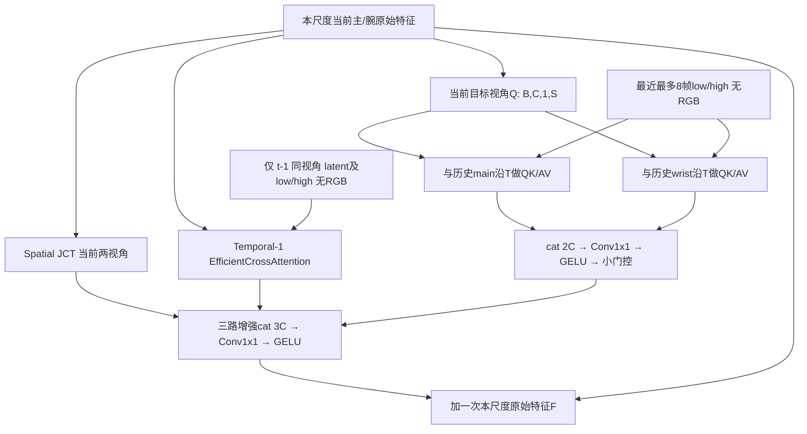

# Temporal-1 / 双视角时间轴 Attention / 无历史 RGB

## 基线与提交

需求来源：`Codex_ThreeBranch_Temporal1_DualView_TimeAttention_NoRGB.md`。
实查远端 codec 仍为 `05a0b57a6cf05b17904ee6b810b454d3d6cc9f03`；
上一轮已发布的三分支版本是 `feat/tri-fusion-gelu` 的
`5c382935c70369270dd8e98f470370e155a91101`。
本轮以后一版本为父提交，独立 worktree `ecomp_codec_temporal1`，
工作分支 `feat/temporal1-dualview-time-norgb`。
实现提交：e9fdd6a8854f5d71184568f71185fd73aa5568b5。

新配置 `tri_temporal1_t8` 显式选择，不替换默认 vts8，保留旧 baseline、
vts8/vts16、tri_fusion8 的执行路径和实验含义。
不改原训练目录、数据、运行进程、已有输出和 checkpoint。

## 架构变化



此结构在 Low/High 两级各执行一次，主、腕分别融合，保留异尺寸支持。
所有分支的 Query 来源为同尺度同一原始输入；没有 JCT 更新后再查询时序分支的依赖。

| 尺度（输入图256×256） | 当前/每路增强 | Q | 每个参考视角K/V | 时间权重 | 三分支cat→融合 |
|---|---|---|---|---|---|
| Low | B×320×16×16 | B×320×1×256 | B×320×T×256 | B×320×T | B×960×16×16 → B×320×16×16 |
| High | B×192×64×64 | B×192×1×4096 | B×192×T×4096 | B×192×T | B×576×64×64 → B×192×64×64 |

上采样仍为 Deconv/GELU/Deconv/GELU，再经第二级融合及 Deconv/GELU/Deconv，
最后 YCoCg→RGB、Sigmoid、Crop。三路增强只在最外层加一次 F。
Spatial 使用原 `ScaledJointContextTransfer(F)-F`，不修改原 JCT/EfficientAttention 数学。

### Temporal-1 的证据

`PreviousFrameAttention.previous_reference()` 唯一历史访问是 `entry = history[-1]`。
参考为上一帧同视角量化 latent 的64→C投影，与对应low/high特征对齐后融合；不遍历旧帧。
Query 经独立 content 投影，仍调用原 `EfficientCrossAttention`：K沿空间归一化、Q沿特征归一化，
先K@V再读取；没有替换为T=1时间Softmax。无历史直接 zeros_like(current)。
新增单测逐级验证：固定t-1而扰动t-2时输出逐值相同；扰动t-1的latent或本级特征时输出变化；
只改另一相机上一帧时，Temporal-1本身不变。

### 双视角沿 T Attention 的证据

`DualViewTimeAttention` 以通道混合1×1卷积生成Q/K/V（groups=1、输入输出C不变）。
空间对齐后将时间单独堆叠，核心为：

```python
scores = (query * key).sum(-1) * S**-0.5  # [B,C,T]
weights = scores.softmax(-1)              # 只沿T
output = (weights.unsqueeze(-1) * value).sum(2)  # [B,C,S]
```

每个目标Query实际分别调用两次该核心：一次匹配历史main，一次匹配历史wrist，
每次包含完整T维；不是沿T循环做T次独立SDPA。两个结果经cat(2C)与可学习view_fusion合并，
再乘非零初始化的小门控，返回纯增强量。未构造T×S空间Token序列，未保留window/global-pool，
也未采用先时间后空间的两阶段设计。

手算单测逐通道核对Softmax和加权和；Hook核对两尺度、两目标视角均收到正确Q/K/V形状并执行两个参考视角。
只改变跨视角历史会改变输出；Q/K/V、两个历史输入、view_fusion、三分支fusion均有有效梯度。

无Age Embedding、view/relative embedding或time bias。
`time_bias` 参数保留明确的未来扩展边界，本基线对非None输入报错，避免静默改变模型含义。
给定固定参考特征，对历史K/V同步重排不改变结果；不能声称独立T轴使其必然感知顺序。
T=1时权重严格为1，投影/后处理前输出严格等于V，此时Q/K的时间选择梯度为零。
每通道的S个空间位置共享一组时间权重；通道混合来自前后投影，
算子不直接匹配跨帧不同空间位置，也不与旧空间Token VTS数学等价。

## 无RGB缓存、状态和兼容性

`TemporalDecodedFrame` 仅有main/wrist的latent、low、high六个Tensor，以及episode/frame身份。
新Decoder的模块树中没有RGB投影、history_image、Age或空间relative/window模块；
引用构建只读取以上特征，所有缓存Tensor detach().clone()。
RGB只作为本帧重建结果 main_hat/wrist_hat 返回，训练MSE/PSNR仍正常。

| 当前帧index | 0 | 1 | 2 | 3 | 8 | 9 | 10 |
|---|---:|---:|---:|---:|---:|---:|---:|
| Temporal-1历史数 | 0 | 1 | 1 | 1 | 1 | 1 | 1 |
| VTS-T8历史数 | 0 | 1 | 2 | 3 | 8 | 8 | 8 |

首次空历史两个时间分支严格零；融合无bias，避免无历史的伪常量增强。
缓存顺序最旧→最新，验证episode/frame连续身份、签名、长度、通道、batch、dtype/device。
frame0重置；旧状态、反序、缺帧、跳帧、跨Episode均拒绝。
状态拒绝乱序与固定K/V的数学置换性质互不矛盾。

新签名 `decoder-temporal1-dualview-time-norgb-v1` 与旧两帧RGB方案隔离。
旧checkpoint直接strict加载失败；显式迁移列出保留/初始化/丢弃条目并重建优化器。
本轮真实旧vts8权重迁移记录：67个analysis、68个Decoder条目复制，56个Decoder条目初始化，62个源条目丢弃；
完整参数清单见 [迁移记录](temporal1_dualview_time_migration.json)。
`--resume` 已有不同配置校验，继续拒绝跨架构恢复；新模型版本与short_history_size=1写入配置。
训练梯度日志对无Age分支记0，而不是假造Age学习参数。

Encoder在父版本已满足 [GELU,GELU,GELU,无激活]，本轮不重复修改；64通道/16倍下采样及梯度回归通过。
新Decoder三处上采样激活为GELU，原JCT LeakyReLU与最终Sigmoid保留；旧配置IGDN/SiLU保留。
`compress/dual_view_codec.py`、Gain、Hyperprior、熵模型、量化、数据读取、RD loss及封包均无改动。

## 实际测试命令与结果

新增14项测试全部通过；全套89项全部通过（此前75项回归+新增14项）。

```sh
CUDA_VISIBLE_DEVICES='' OMP_NUM_THREADS=2 MKL_NUM_THREADS=2 OPENBLAS_NUM_THREADS=2 \
  python -m unittest discover -s tests -p test_temporal1_dualview_time.py -v
CUDA_VISIBLE_DEVICES='' OMP_NUM_THREADS=2 MKL_NUM_THREADS=2 OPENBLAS_NUM_THREADS=2 \
  python -m unittest discover -s tests -v
```

日志：[14项定向测试](temporal1_dualview_time_targeted.txt)、[89项完整回归](temporal1_dualview_time_all_tests.txt)。
覆盖手算核心/T=1、时间置换、双视角形状与调用、跨视角扰动、双尺度梯度、Temporal-1窗口、
无RGB模块/缓存、三路并行cat、首帧零、11帧连续状态、8帧截断、batch1/2、256×256与异尺寸、
激活与全部旧配置回归、显式迁移和真实码流。

真实码流测试实际运行10帧（超过要求3帧）：两个视角分别用(level1,alpha.25)与(level2,alpha0)，
独立接收端移除g_a/h_a仍可逐包解码，forward与真实解码在1e-6容差内一致，estimated/actual bpp有限。
相同当前Encoder权重/CDF/码率下，旧tri_fusion8与新结构生成相同ECD1包；Decoder不参与编码。
此处不宣称跨上一轮Encoder激活语义改变仍保持旧码流字节一致。

另外实际执行合成1条3帧128×128 HDF5的CPU CLI测试：

```sh
CUDA_VISIBLE_DEVICES='' OMP_NUM_THREADS=2 MKL_NUM_THREADS=2 OPENBLAS_NUM_THREADS=2 \
  python tools/train_libero.py --data /tmp/synthetic_hdf5 --output /tmp/new_run \
  --device cpu --epochs 1 --steps 3 --threads 2 --decoder-config tri_temporal1_t8 \
  --migrate-from /path/to/vts8_batch16/latest.pt
```

合成输入通过临时脚本创建，实际随机目录及原始命令参数见[CLI日志](temporal1_dualview_time_cli_smoke.txt)。
完整3步与双优化器通过、完成checkpoint保存；验证配置short_history_size=1、激活标记、版本正确。
这不是正式数据训练，不启动新GPU任务，不改任何旧checkpoint。

GPU检查实际为：0号已用36268MiB/利用率30%；其余健康卡利用率51%～100%，6号设备异常。
无空闲GPU，本轮跳过GPU功能、前反向显存测试，不能宣称它们已通过。

## CPU开销对照

```sh
CUDA_VISIBLE_DEVICES='' OMP_NUM_THREADS=2 MKL_NUM_THREADS=2 OPENBLAS_NUM_THREADS=2 \
  python tools/benchmark_decoder_v5.py --case tri_fusion8 --samples 3
CUDA_VISIBLE_DEVICES='' OMP_NUM_THREADS=2 MKL_NUM_THREADS=2 OPENBLAS_NUM_THREADS=2 \
  python tools/benchmark_decoder_v5.py --case tri_temporal1_t8 --samples 3
```

两个配置顺序运行，CPU两线程、batch1、双256×256、满8帧独立clone有效历史、随机latent/参数，
各预热1次、测3次；仅Decoder，不含Encoder或熵编解码。原始样本、参数、MAC和RSS见
[CPU对照JSON](temporal1_dualview_time_cpu_comparison.json)。

| 配置 | Decoder参数 | 缓存Tensor | Decoder中位数 |
|---|---:|---:|---:|
| 旧tri_fusion8 | 19,974,707 | 66 MiB | 1683.084 ms |
| 新tri_temporal1_t8 | 18,393,795 | 54 MiB | 777.852 ms |

以上是共享服务器上的实际三次测量，不可据此推断训练后RD收益、GPU性能或普遍加速倍数。
缓存减少12MiB正好对应8帧、双256×256、FP32 RGB，不含模型/临时Tensor。

权重条目数量也不同：默认low中，旧token VTS每目标视角为8 heads×256 queries×4096 keys；
新时间算子每目标视角为2参考视角×320通道×8时间权重。high中对应新2×192×8权重。
这些仅是理论权重条目，不是FLOPs；S仍参与新QK/AV内积，不可单凭条目数宣称实测提速。
profiling工具新增temporal_axis_attention MAC计数，避免把新核心误计为旧SDPA或漏计。

## 变更文件与未验证项

- `compress/decoder_v5.py`：新cache、Temporal-1、双视角沿T核心、两级并行Decoder、配置和迁移说明。
- `tools/train_libero.py`：新版本/短窗配置记录、无Age分支梯度日志；不改loss或DataLoader。
- `tools/benchmark_decoder_v5.py`：新核心MAC统计；旧测试与路径保留。
- `tests/test_temporal1_dualview_time.py`：14项验收。
- `README.md` 与本报告/实际日志：入口、形状和语义限制。

最终CPU失败项：无。未验证：GPU/混合精度、完整正式训练、画质/码率收益及长期训练稳定性。
