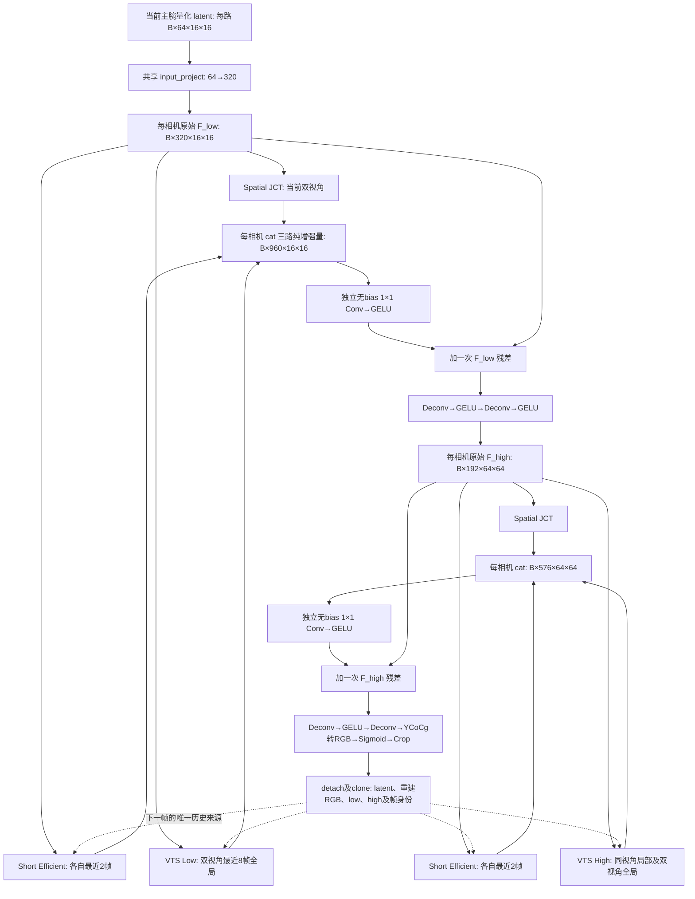

# 三分支并行 Decoder 实施与验证

## 版本、范围与隔离

任务来源：`Codex_Decoder_ThreeBranch_Fusion_Modification.md`。
基于 GitHub `sude-sudo/ecomp_codec` 的 `codec` 分支提交
`05a0b57a6cf05b17904ee6b810b454d3d6cc9f03`，与任务书核对版本一致。
实现提交：27bd3c8a6510744839032f1fc5d5193baffbb77f（最终报告提交的父提交）。

原训练工作区停留在本地 `15b4f0b`，并存在 README、DecoderState 字段、批处理、
Parquet 和训练入口等未提交改动。这些内容不合并、不修复、不覆盖。
本次在独立 worktree `ecomp_codec_tri_fusion`、分支 `feat/tri-fusion-gelu` 实施。
运行中的实验、原数据、输出、日志、checkpoint 和 source_snapshot 均未修改。
用户明确要求修改后推送 GitHub，因此交付为新远端分支，不合并 `codec`。

## 结构与数据流



以下为 256×256 每视角输入、默认 M=320/N=192 的形状；异尺寸相机独立保持各自 H/W。

| 层/位置 | 每相机输出 |
|---|---|
| Encoder 四级输出 | B×64×16×16，连续 y，末层无激活 |
| input_project | B×320×16×16 |
| low 三条增强分支 | 每条 B×320×16×16 |
| low cat / 融合 | B×960×16×16 → B×320×16×16 |
| decoder_1[0:2] | B×192×32×32，Deconv + GELU |
| decoder_1[2:4] | B×192×64×64，Deconv + GELU |
| high 三条增强分支 | 每条 B×192×64×64 |
| high cat / 融合 | B×576×64×64 → B×192×64×64 |
| decoder_2[0:2] | B×192×128×128，Deconv + GELU |
| decoder_2[2] | B×3×256×256 |
| RGB/Sigmoid/Crop | B×3×原始H×原始W，范围 [0,1] |

### 三路 Q/K/V 与融合

| 分支 | Q 来源 | K/V 来源 | 数学与边界 |
|---|---|---|---|
| Spatial | 本级原始 F，经既有 JCT 内部 ResidualBlock | 当前另一相机，同尺度特征 | 既有 EfficientAttention 和 Refine 不变；JCT(F)-F 为增强量 |
| Short | 本级原始 F，经独立 content 投影 | 仅本相机 history[-2:] 的量化 latent、已解码 RGB、age embedding | 直接复用 EfficientCrossAttention：K 对空间 softmax，Q 对特征 softmax，先 K@V，再读出；未用 SDPA 替代 |
| Long VTS | 本级原始 F | history[-8:] 两相机 latent、重建 RGB、相应 low/high Decoder feature | 原 SDPA、8 heads（默认宽度）、query chunk、age/view/relative bias 均不改；高尺度同视角局部及两相机全局 |

Short 在两个尺度独立实例化；64 通道历史 latent 显式投影到本级 C，
resize 到该相机 Query 尺度，再与 RGB 投影融合，不混用 320/192/64 通道。
Long 使用原模块 `VTS(F, refs) - F` 得到纯增强量。
三个分支之间无 Query 的串行依赖；Python 顺序调用不表示图上的串行依赖。

主腕相机各自以 `torch.cat(..., dim=1)` 形成 3C 通道，分别通过
`Conv2d(3C,C,1,bias=False) + GELU`，仅外层加一次 F。
投影初始权重乘以 0.1，非零初始化保留各支路的梯度。
无历史时短/长分支为确切零；无 bias 和 GELU(0)=0 保证无常量伪增强。

## 激活修改与兼容性

- Encoder 仅 stage 0/1/2 保留原 GELU；stage 3 最后一步为原 depthwise Conv，卷积拓扑和参数键未改。
- 仅 `tri_fusion8` 的 `decoder_1[1]`、`decoder_1[3]`、`decoder_2[1]` 从 IGDN 改为 GELU。
- `baseline`、`vts8`、`vts16`、`wide-ldmic` 等旧 Decoder 的三处 IGDN 与旧执行路径保留。
- JCT LeakyReLU、VTS relative MLP SiLU、历史三源融合 GELU、输出 Sigmoid 保持原样。
- `compress/decoder.py`、Gain、Hyperprior、概率/量化、色彩变换、码流容器和双视角独立编码 API 未修改。
- 所有当前配置共享的新 Encoder 语义已改变；历史 Encoder 的精确复现须 checkout 基准 SHA。
  容器 ECD1/ECG1/ECH1 不变，不宣称旧/新 Encoder 码流字节一致。

## 状态、因果性与消融

`FusionDecodedFrame` 复用原八个缓存 Tensor，另存 episode_id/frame_index；
`DecoderState` 仍使用有序 history 和 signature。每个 Tensor detach().clone()。
新 signature 隔离旧状态，并包含窗口、宽度、分支 mask、融合尺度。
显式检查历史帧身份，拒绝反序、缺帧、错误轨迹及错误签名；frame_index=0 重置。

| 当前 frame_index | 0 | 1 | 2 | 3 | 8 | 9 |
|---|---:|---:|---:|---:|---:|---:|
| Short 历史数 | 0 | 1 | 2 | 2 | 2 | 2 |
| VTS 历史数 | 0 | 1 | 2 | 3 | 8 | 8 |

缓存中不存在原始输入 RGB；接收侧独立熵解码即可得到全部历史来源。

| 对照配置 | 空间 | Short | Long | 主干上采样 |
|---|---|---|---|---|
| baseline | 原 V4 两级 JCT | 原 V4 两帧路径 | 无 | 原 IGDN |
| vts8 | 原 V5 两级 JCT | 无 | 原 V5 串行 VTS8 | 原 IGDN |
| tri_fusion8 | 两级同输入并行 | 最近2帧 | 最近8帧 | 三处 GELU |
| tri_fusion8, fusion_scales=('low',) | low 并行融合，高级仅 JCT | 仅 low | 仅 low | 三处 GELU |

API 的 branch_mask=(spatial,short,long) 可分别关闭任一分支。
测试验证关闭分支得到零，其他分支输出逐值不变，并仍可合法更新因果状态。
默认配置仍为 vts8；新实验须显式选择 tri_fusion8。本次未启动正式实验。

## 迁移与训练入口

`migrate_checkpoint` 对 analysis 严格加载；Decoder 仅复制同名同形状张量，
列出 copied_analysis/copied_decoder/initialized_decoder/discarded_source，最终 strict=True。
旧 IGDN 参数丢弃，新 Short/Fusion 参数重新初始化。
实测从上一轮 vts8 batch16 权重迁移：67 个 analysis 条目、112 个 Decoder 条目保留，
58 个 Decoder 条目初始化，18 个旧 IGDN 条目丢弃。
完整列表：[migration.json](tri_fusion_migration/migration.json)。

`tools/train_libero.py --migrate-from` 在加载后新建主/辅助优化器，从帧0建立历史。
`--resume` 只接受同 Decoder 配置及 `encoder_output_activation='none'` 的 checkpoint，
避免将旧优化器直接用于新结构。训练入口默认 CPU，CUDA 设备须显式选择。
原 HDF5 DataLoader、RD loss 与双优化器机制保留，未引入数据读取重写或正式 GPU 训练。

## 实际验证

全部功能检查使用 CPU、OMP/MKL 两线程；最终全套命令屏蔽 CUDA。

```sh
# 基准提交从 git archive 导出至独立临时目录后运行：65 项通过。
CUDA_VISIBLE_DEVICES='' OMP_NUM_THREADS=2 MKL_NUM_THREADS=2 \
  python -m unittest discover -s tests -v
# 本实现最终同一命令：75 项通过（65 项回归 + 10 项新三分支测试）。

# 默认宽度、新模型、实际旧权重迁移、三帧前反向与双优化器：
CUDA_VISIBLE_DEVICES='' OMP_NUM_THREADS=2 MKL_NUM_THREADS=2 \
  python tools/smoke_decoder_v5.py --decoder-config tri_fusion8 --frames 3 --size 64 \
  --checkpoint /path/to/vts8_batch16/latest.pt --output /new/path/migration

# CPU 满8帧窗口、默认宽度、256×256 双视角单样本 profile：
CUDA_VISIBLE_DEVICES='' OMP_NUM_THREADS=2 MKL_NUM_THREADS=2 \
  python tools/benchmark_decoder_v5.py --case tri_fusion8 --samples 1
```

- [基准 65 项完整输出](tri_fusion_baseline_clean_tests.txt)。
- [最终 75 项完整输出](tri_fusion_all_tests.txt)。
- [真实旧权重迁移、CPU 三帧训练 smoke](tri_fusion_cpu_migration_smoke.txt)。
- [训练 CLI 的三步完整运行](tri_fusion_cli_smoke.txt)：合成 1 条 3 帧双128×128 HDF5，
  显式 tri_fusion8/CPU/--migrate-from/--steps 3；保存检查点和 completed.json。
- [CPU 单样本 profile](tri_fusion_cpu_profile.json)：只验证现有 profiling 工具兼容新增帧身份字段；
  一次测量不能证明相对延迟改善，不作性能对比结论。

覆盖内容：

1. Encoder 四级激活、三个新 GELU 与旧 Decoder IGDN 回归，默认 8 heads。
2. Hook 证明同尺度三个分支收到同一原始输入，实际 fusion 输入为三路增强的通道 cat。
3. 首帧两个时序支路严格为零、无 bias、全关分支时单残差精确等于 F。
4. 连续0～9帧、Short 2帧/VTS 8帧窗口、reset、乱序/缺帧/跨Episode拒绝、缓存隔离。
5. Batch 1/2，默认宽度，256×256 与 128×192 异尺寸、小尺寸；RGB 有限且在[0,1]。
6. 两尺度 JCT/Short/VTS/Fusion 有限非零梯度；Short 和 VTS 的 Q/K/V 梯度有效。
7. 改动历史主腕 latent/RGB/low/high 影响相应输出；Short 仅本视角最近2帧；Long 不读8帧以外。
8. 单支路关闭不改变其余增强量；低尺度融合消融可运行。
9. 连续10帧真实 compress/decompress，包括满8帧窗口；独立接收端移除 g_a/h_a 仍可解码。
   相机分别使用 (level=1,alpha=.25)/(level=2,alpha=0)，包头/码率/实际BPP有效。
   eval 确定性 forward 与解码在1e-6容差内一致；不要求随机噪声训练量化与真实解码逐值相同。
10. 旧权重直接严格加载新结构会失败；显式迁移后严格加载成功，且新优化器状态为空。

最终失败项：无（以最终日志为准）。未验证：正式数据训练后 RD、PSNR/BPP收益、
GPU性能、多设备及混合精度。功能通过不代表质量或速度提升。

## 修改文件

| 文件 | 用途 |
|---|---|
| compress/decoder_tri_fusion.py | Short 分支、两尺度并行增强融合、带帧身份缓存 |
| compress/decoder_v5.py | 显式 tri_fusion8 配置与迁移说明，原注意力数学不变 |
| compress/lightweight_encoder.py | 最后 stage 去 GELU |
| tools/train_libero.py | 配置入口、显式迁移、新优化器、激活语义校验、CPU默认 |
| tools/benchmark_decoder_v5.py | 兼容带整数帧身份的缓存，统计 Short/Fusion 参数 |
| tests/test_decoder_tri_fusion.py | 10 项新增验收测试 |
| tests/test_lightweight_encoder.py | 更新末层无激活的结构断言 |
| README.md | 入口、消融、迁移、历史 Encoder 语义说明 |
| reports/tri_fusion_* | 架构报告、实际测试日志和迁移清单 |
